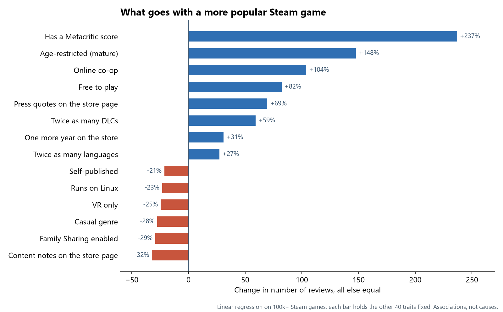

<h1 align="center">What Makes a Steam Game Popular?</h1>

<p align="center">
  <strong>A look at 100,000+ games on Steam to find which traits go with more players.</strong><br>
  A statistics project that predicts how many reviews a game gets, and explains which traits matter and by how much.
</p>

<p align="center">
  
</p>

---

## Key findings

The number of reviews is used as a stand-in for popularity. Comparing games that are alike in everything else:

- **Visibility goes with popularity.** Games with a Metacritic score have about 3.4× as many reviews, and quoting the press on the store page goes with 69% more.
- **Time and content add up.** Each extra year on the store adds about 31%, and twice as many DLCs goes with 59% more reviews.
- **Reach helps.** Twice as many languages goes with 27% more reviews; online co-op roughly doubles them.
- **Some traits go the other way**, like casual games and self-published titles.

These are associations, not causes. Big games attract critics, and popular games release more DLC, not only the other way around.

**How well it predicts:** the easy-to-explain linear model accounts for about half of the differences between games. More complex models predict better but no longer say why:

| Model | Share of the variation it explains (R², test set) |
| :--- | :---: |
| Linear regression (41 traits) | 0.488 |
| Gradient Boosting | 0.624 |
| Kumo Tabular (NVIDIA) | 0.681 |

---

## How it works

1. **Data:** the [Steam Games Dataset](https://www.kaggle.com/datasets/fronkongames/steam-games-dataset) by Martin Bustos Roman (Kaggle, version 55), with 125,855 games.
2. **Cleaning:** games with no activity at all are removed, leaving 101,276. Missing values are filled in, and new traits are built from the raw columns: age, genres, store features, number of languages, DLCs, screenshots and more.
3. **Popularity measure:** the number of reviews, on a log scale, because a handful of hits have millions while most games have a few.
4. **Choosing traits:** 50 candidates are narrowed to 41 by adding and removing them one at a time (forward and backward selection, which agree).
5. **Testing:** the model is fit on 70% of the games and checked on the other 30%, plus 10-fold cross-validation. Train and test errors match, so it isn't memorising the data.
6. **Comparing:** Ridge, Lasso, Random Forest, Gradient Boosting and NVIDIA's Kumo Tabular are tried for comparison.

The full analysis, written in Spanish, is in [`Steam_Popularity_Analysis.ipynb`](Steam_Popularity_Analysis.ipynb).

---

## Run it

You need [uv](https://docs.astral.sh/uv/getting-started/installation/), which also installs Python 3.12.

```bash
git clone https://github.com/GabGP/steam-popularity-analysis.git
cd steam-popularity-analysis
uv sync
uv run jupyter lab
```

Open `Steam_Popularity_Analysis.ipynb` and run all cells. The dataset downloads automatically with `kagglehub` the first time. VS Code works too: pick `.venv` as the kernel.

**Optional, the Kumo Tabular section (8.3):** it needs an NVIDIA GPU with a driver that supports CUDA 13. Install it with `uv sync --group kumo`, and keep using `--group kumo` on every later sync, since a plain `uv sync` removes PyTorch. Without a GPU, everything else runs the same. The first run downloads the model weights from Hugging Face.

**Notes**

- Notebook outputs are stripped before each commit with `nbstripout`, so run the notebook to see tables and charts. To turn it on in a fresh clone: `uv run nbstripout --install`.
- `pyproject.toml` sets `system-certs = true` because on some networks uv can't verify PyPI's certificates with its bundled ones.

---

Made by [@GabGP](https://github.com/GabGP) for Operations Research 2 (Investigación de Operaciones 2).
